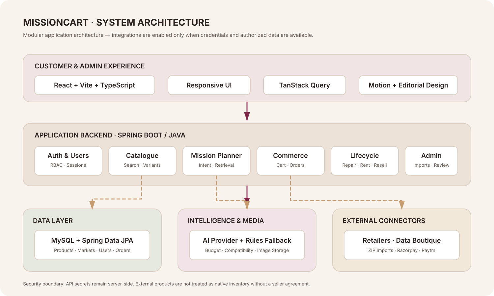
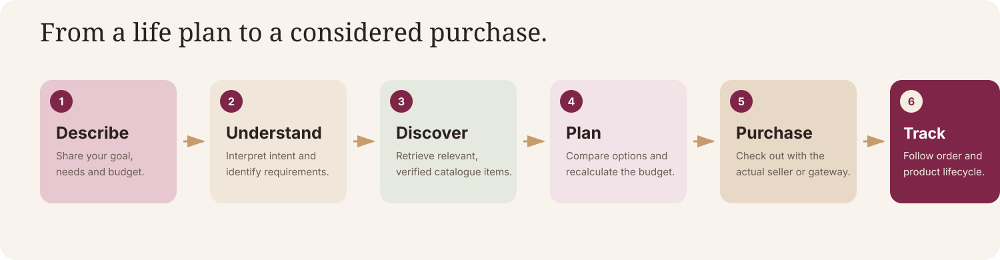

<div align="center">
  
  <p><strong>Shopping by Purpose, Not Products.</strong></p>
  <p><strong>Author:</strong> <a href="https://github.com/Gopika-sys">Gopika</a></p>
  <p>Describe what you are preparing for. Discover relevant products, plan a budget and choose how to shop.</p>
  <p>
    
    
    
    
    
  </p>
  <p>
    
    
    
  </p>
</div>

<p align="center">
  
</p>

<p align="center"><sub>Editorial gallery artwork for the MissionCart visual direction. Illustrative imagery only; product listings must use separately verified catalogue photographs.</sub></p>

---

## Contents

- [Overview](#overview)
- [What makes MissionCart different](#what-makes-missioncart-different)
- [Visual direction](#visual-direction)
- [Product and retailer ecosystem](#product-and-retailer-ecosystem)
- [International shopping](#international-shopping)
- [Core features](#core-features)
- [System architecture](#system-architecture)
- [Technology stack](#technology-stack)
- [Repository structure](#repository-structure)
- [Getting started](#getting-started)
- [Environment configuration](#environment-configuration)
- [Database and migrations](#database-and-migrations)
- [Catalogue data and ZIP imports](#catalogue-data-and-zip-imports)
- [Product images and data quality](#product-images-and-data-quality)
- [AI mission planner](#ai-mission-planner)
- [Budget and compatibility engines](#budget-and-compatibility-engines)
- [Cart, checkout and payments](#cart-checkout-and-payments)
- [Authentication and security](#authentication-and-security)
- [API overview](#api-overview)
- [Testing and quality checks](#testing-and-quality-checks)
- [Deployment](#deployment)
- [Configuration and integration status](#configuration-and-integration-status)
- [Responsible data use](#responsible-data-use)
- [Roadmap](#roadmap)
- [Contributing](#contributing)
- [License](#license)

---

## Overview

**MissionCart** is an AI-assisted, purpose-first commerce platform. Instead of requiring customers to know an exact product name, MissionCart lets them describe a goal, event, task or everyday situation in natural language.

For example:

> “I’m setting up a small study space. I have ₹8,000, already own a laptop and want a lamp, comfortable chair, desk organiser and a few useful accessories.”

MissionCart is designed to interpret the request, identify shopping requirements, retrieve relevant catalogue records, separate essentials from optional upgrades and help the customer understand the expected spend before purchasing.

The platform is intended to support customers across different countries and product markets. A selected country determines the applicable catalogue, currency, product variants and market information where those records have been imported and verified.

> **Project status:** This README describes the agreed MissionCart architecture and intended capabilities. It does not certify that every feature, retailer feed, dataset, payment method or deployment is currently connected. See [Configuration and integration status](#configuration-and-integration-status) and update this document after verifying the implementation in the repository.

## What makes MissionCart different

| Traditional product-first shopping | MissionCart's purpose-first approach |
|---|---|
| Start with a product keyword | Start with a goal or situation |
| Browse products one by one | Build a relevant shopping plan |
| Manually track the budget | Recalculate selected-item totals |
| Search for alternatives separately | Compare suitable catalogue alternatives |
| Repeat information across sessions | Save missions and existing possessions |
| Stop at checkout | Support post-purchase lifecycle workflows |

### Example use cases

- Preparing for a new home or hostel.
- Building a study or work-from-home setup.
- Planning travel or an event.
- Finding clothing for a particular occasion.
- Discovering beauty and personal-care products.
- Setting up a kitchen or home gym.
- Comparing products within a defined budget.
- Finding products for a new situation not represented by a preset template.

The examples are suggestions, not a fixed list of supported mission types.

## Visual direction

MissionCart uses a warm editorial design language with product-led layouts, expressive typography, generous spacing and image-rich collections.

<p align="center">
  
</p>

<sub>The banner is illustrative brand artwork, not a representation of verified products or retailer inventory.</sub>

### Brand palette

| Token | Colour | Suggested use |
|---|---|---|
| Burgundy | `#7F2548` | Primary actions, key highlights |
| Dusty blush | `#E7C8D0` | Secondary surfaces and accents |
| Warm ivory | `#F3EDE3` | Main page canvas |
| Caramel | `#C69B6D` | Decorative details and selected highlights |
| Deep chocolate | `#2B2220` | Headings and primary text |

### Typography

- **Display:** Fraunces or Cormorant Garamond.
- **Interface:** Plus Jakarta Sans or Inter.

### Editorial UI principles

- Category-specific landing pages rather than one generic listing layout.
- Multi-image collection panels and asymmetric collages.
- Distinct collection identities for Fashion, Beauty, Home, Electronics, Grocery, Travel and other categories.
- Smooth, restrained motion and image hover transitions.
- Responsive product grids and accessible controls.
- `prefers-reduced-motion` support.

The visual direction is inspired by editorial template and fashion-lifestyle presentation. MissionCart retains its own branding and must use only photographs it is authorised to display.

## Product and retailer ecosystem

The intended source ecosystem includes the following Indian retail destinations. A source being listed here does **not** mean its API, affiliate feed or product inventory is already connected.

| Source | Typical catalogue focus | Official website |
|---|---|---|
| Amazon India | General merchandise, electronics, home, study and personal care | [amazon.in](https://www.amazon.in/) |
| Flipkart | Electronics, appliances, home and fashion | [flipkart.com](https://www.flipkart.com/) |
| Meesho | Budget fashion, home, storage and decor | [meesho.com](https://www.meesho.com/) |
| JioMart | Grocery, food and household essentials | [jiomart.com](https://www.jiomart.com/) |
| Tata CLiQ | Fashion, lifestyle, home and gadgets | [tatacliq.com](https://www.tatacliq.com/) |
| Myntra | Clothing, footwear, bags and accessories | [myntra.com](https://www.myntra.com/) |
| AJIO | Casual fashion, streetwear and accessories | [ajio.com](https://www.ajio.com/) |
| Savana | Trend-led apparel and accessories | [savana.com](https://www.savana.com/) |
| Nykaa | Beauty, skincare and haircare | [nykaa.com](https://www.nykaa.com/) |
| Purplle | Beauty, skincare and grooming | [purplle.com](https://www.purplle.com/) |
| DailyObjects | Tech accessories, desk and carry products | [dailyobjects.com](https://www.dailyobjects.com/) |
| Nestasia | Home decor, ceramics and tableware | [nestasia.in](https://nestasia.in/) |
| Croma | Consumer electronics and appliances | [croma.com](https://www.croma.com/) |

### Additional product-information datasets

MissionCart may also import appropriately licensed information from:

- [Open Food Facts](https://world.openfoodfacts.org/) — food and grocery product information.
- [Open Beauty Facts](https://world.openbeautyfacts.org/) — beauty and personal-care product information.
- [Open Products Facts](https://world.openproductsfacts.org/) — general product information.

These are **product-information databases, not retailers**. Their records do not by themselves prove a current selling price, seller inventory, delivery availability or a purchasable checkout URL. Preserve the applicable database licences, attribution and database-share-alike obligations.

## International shopping

The country selector is intended to support a complete searchable list based on recognised country/territory codes, not just a short list of popular markets.

For each market, MissionCart should store or derive:

- Country and ISO code.
- Currency and locale.
- Available catalogue status.
- Product and variant availability.
- Market-specific seller/source.
- Source currency and last price verification.
- Shipping or delivery eligibility, when verified.

A country must remain selectable even if its catalogue is not yet imported. In that case, display an honest **Dataset pending** or **Catalogue unavailable** state instead of silently switching the customer to another country.

### Data Boutique — fashion and luxury dataset discovery

Reference collection: [Data Boutique — Fashion & Luxury Brands](https://www.databoutique.com/collections-details/fashion+luxury+brands/r/recduNgC35Z9tEIdZ)

Data Boutique can be used as an authorised source of dataset discovery and, where licensed and delivered, product information for supported fashion and luxury markets. Its catalogue API requires an account token. Dataset metadata discovery must not be confused with access to a complete product feed.

Integration documentation: [Data Boutique dataset catalogue API](https://support.databoutique.com/article/dadd77p45d-5-2-how-to-access-the-data-boutique-dataset-catalog-via-api)

Important implementation rules:

1. Keep the Data Boutique token on the backend only.
2. Inspect actual dataset geography, schema, source and delivery details.
3. Import only samples or full datasets that the account is authorised to access.
4. Do not assume the catalogue API returns every product record.
5. Do not assume Data Boutique product records include product photographs.
6. Obtain image assets separately through authorised brand/retailer sources or supplied ZIP archives.
7. Do not display a dataset as live retailer inventory unless an actual seller/checkout integration exists.

## Core features

The following describes the intended product scope. Each item should be marked as implemented only after its API, UI and tests have been verified.

### 1. Universal AI mission planner

- Natural-language shopping requests.
- Intent, context and constraint extraction.
- Budget and timeframe parsing.
- Dynamic category and requirement detection.
- Retrieval from MissionCart's own catalogue.
- Essential and optional separation.
- Recommendation explanations.
- Deterministic fallback when an AI provider is not configured.

### 2. Product discovery

- Category, brand and retailer browsing.
- Search, filters, sorting and pagination.
- Country-aware market filtering.
- Product details and variants.
- Collection and editorial category pages.
- Wishlist and comparison.

### 3. Smart budget planner

- Selected-product subtotal.
- Essential and optional spend.
- Quantities and replacements.
- Shipping, tax and discounts when known.
- Remaining budget.
- Clear separation of verified, estimated, expired and unavailable prices.

Missing prices must never be silently converted to `₹0`.

### 4. Existing possessions

Customers can record products they already own. Mission planning can use this information to avoid recommending unnecessary duplicate purchases.

### 5. Compatibility checks

Structured compatibility rules can evaluate relevant product attributes such as dimensions, electrical ratings, connectors, sizes and product-specific usage constraints. If required information is missing, the result should be **Not verified**, not automatically Compatible.

### 6. Smart replacement

Find alternatives from real catalogue records and recalculate the mission after a replacement.

### 7. Shared missions

Create invitation-based shopping rooms with member roles, item assignments and shared progress. Real-time updates may use WebSocket/STOMP when configured.

### 8. Product lifecycle

Support request workflows for repair, exchange, rent and resale. Actual fulfilment requires connected service providers or seller operations; a submitted request is not proof that a provider has accepted it.

### 9. Commerce and orders

- Persistent cart and wishlist.
- Product variants and stock validation.
- Address and delivery selection.
- Server-side order pricing.
- Payment gateway integration.
- Order history and status.
- Refund tracking where supported.

### 10. Admin and catalogue management

- Product, brand and category management.
- Retailer/source configuration.
- Bulk CSV, JSON and ZIP ingestion.
- Image verification and approval.
- Inventory and order management.
- Import reports and audit logs.

## System architecture

MissionCart is intended to use a modular monolith: one Spring Boot backend organised into business modules, with external services connected through dedicated adapters.



### Core request flow

1. The React application sends a request to the backend.
2. Spring Boot validates the request and identifies the user's country and market context.
3. The mission planner interprets the request.
4. The catalogue service retrieves matching product records.
5. Budget and compatibility services evaluate the selected products.
6. The backend returns structured results to the frontend.
7. Checkout revalidates product prices, variants, stock and payable amount before creating a payment order.

### Shopping journey



## Technology stack

The following is the agreed target stack. Verify the actual repository before changing dependency versions or assuming a module exists.

| Layer | Technology |
|---|---|
| Frontend | React, Vite, TypeScript |
| Routing | React Router |
| UI motion | Motion / Framer Motion |
| Data fetching | TanStack Query, Axios |
| Forms | React Hook Form, Zod |
| Backend | Java 21, Spring Boot 3.x |
| API | Spring Web, REST, OpenAPI |
| Persistence | Spring Data JPA, Hibernate |
| Database | MySQL 8 |
| Schema migrations | Flyway |
| Authentication | Spring Security, BCrypt, secure token/cookie strategy |
| Real-time collaboration | Spring WebSocket with STOMP, when enabled |
| Image storage | Cloudinary or S3-compatible object storage |
| Payments | Razorpay and/or Paytm, subject to merchant activation |
| Local services | Docker Compose |

## Repository structure

The exact folder names may differ in the existing repository. A target modular structure is:

```text
missioncart/
├── frontend/
│   ├── public/
│   └── src/
│       ├── assets/
│       ├── components/
│       ├── layouts/
│       ├── pages/
│       ├── features/
│       │   ├── auth/
│       │   ├── catalogue/
│       │   ├── products/
│       │   ├── missions/
│       │   ├── budget/
│       │   ├── compatibility/
│       │   ├── wishlist/
│       │   ├── cart/
│       │   ├── checkout/
│       │   ├── international/
│       │   ├── shared-shopping/
│       │   ├── lifecycle/
│       │   └── admin/
│       ├── hooks/
│       ├── services/
│       ├── store/
│       ├── styles/
│       ├── types/
│       └── utils/
├── backend/
│   ├── pom.xml
│   └── src/
│       ├── main/java/com/missioncart/
│       │   ├── config/
│       │   ├── security/
│       │   ├── common/
│       │   ├── auth/
│       │   ├── users/
│       │   ├── catalogue/
│       │   ├── products/
│       │   ├── retailers/
│       │   ├── countries/
│       │   ├── missions/
│       │   ├── ai/
│       │   ├── budget/
│       │   ├── compatibility/
│       │   ├── cart/
│       │   ├── checkout/
│       │   ├── payments/
│       │   ├── orders/
│       │   ├── shared/
│       │   ├── lifecycle/
│       │   └── admin/
│       └── test/java/com/missioncart/
├── scripts/
│   └── catalog-import/
├── database/
│   └── seed/
├── docs/
│   ├── ARCHITECTURE.md
│   ├── DATABASE.md
│   ├── API.md
│   ├── IMAGE_SOURCING.md
│   └── INTEGRATIONS.md
├── architecture.svg
├── mission-flow.svg
├── missioncart-banner.svg
├── missioncart-gallery-banner.png
├── missioncart-gallery-banner.webp
├── docker-compose.yml
├── .env.example
├── .gitignore
├── CLAUDE.md
└── README.md
```

## Getting started

### Prerequisites

Install the following tools before running the project:

- Git.
- Java Development Kit 21.
- Maven 3.9+ or the project's Maven Wrapper (`mvnw` / `mvnw.cmd`).
- Node.js 20+ and npm.
- Docker Desktop with Docker Compose, or a local MySQL 8 installation.

Check the installations:

```bash
java -version
mvn -version
node -v
npm -v
docker --version
docker compose version
```

### 1. Clone and enter the repository

```bash
git clone <YOUR_REPOSITORY_URL>
cd missioncart
```

If the project is already on your computer, open its existing root folder instead.

### 2. Configure environment variables

Copy the example file:

**Windows PowerShell**

```powershell
Copy-Item .env.example .env
```

**macOS / Linux**

```bash
cp .env.example .env
```

Configure the values required by your local setup. Never commit `.env` or real credentials.

> Spring Boot does not automatically read every `.env` file in every configuration. Ensure the project explicitly loads it, uses a compatible environment loader, or exports the variables into the process environment.

### 3. Start MySQL

If the repository includes a MySQL service in Docker Compose:

```bash
docker compose up -d mysql
```

Check the database container:

```bash
docker compose ps
```

If the Compose service has a different name, use the actual service name from `docker-compose.yml`.

### 4. Run database migrations and start the backend

From the backend directory:

```bash
cd backend
mvn spring-boot:run
```

On Windows, the Maven Wrapper can be used when present:

```powershell
.\mvnw.cmd spring-boot:run
```

If a Maven Wrapper is not present, install Maven and use `mvn spring-boot:run`.

Flyway should apply pending migrations through the configured application profile or documented migration command. Confirm the actual Flyway configuration before relying on automatic migration at startup.

### 5. Start the frontend

Open another terminal:

```bash
cd frontend
npm install
npm run dev
```

Open:

```text
http://localhost:5173
```

The frontend API base URL should point to the Spring Boot backend, for example `http://localhost:8080`, using the value configured in `VITE_API_BASE_URL`.

### 6. Build the application

Frontend:

```bash
cd frontend
npm run build
```

Backend:

```bash
cd backend
mvn clean verify
```

Use the repository's actual scripts and Maven profiles if they differ.

## Environment configuration

Create `.env.example` with placeholders only. The following names are a configuration reference; retain or adapt the names used by the actual codebase.

```dotenv
# Application
APP_ENV=development
FRONTEND_URL=http://localhost:5173
BACKEND_URL=http://localhost:8080
SERVER_PORT=8080

# MySQL
SPRING_DATASOURCE_URL=jdbc:mysql://localhost:3306/missioncart
SPRING_DATASOURCE_USERNAME=missioncart_user
SPRING_DATASOURCE_PASSWORD=CHANGE_ME

# JPA / Flyway
SPRING_JPA_HIBERNATE_DDL_AUTO=validate
SPRING_FLYWAY_ENABLED=true

# Authentication — use strong, randomly generated secrets
JWT_ACCESS_SECRET=CHANGE_ME_WITH_A_LONG_RANDOM_SECRET
JWT_REFRESH_SECRET=CHANGE_ME_WITH_A_DIFFERENT_LONG_RANDOM_SECRET

# AI provider (optional; deterministic fallback should remain available)
AI_PROVIDER=none
GEMINI_API_KEY=
OPENAI_API_KEY=

# Data Boutique (backend only)
DATABOUTIQUE_API_TOKEN=

# Image/object storage (optional until configured)
CLOUDINARY_CLOUD_NAME=
CLOUDINARY_API_KEY=
CLOUDINARY_API_SECRET=
S3_ENDPOINT=
S3_BUCKET=
S3_ACCESS_KEY=
S3_SECRET_KEY=

# Razorpay (use test credentials for development)
RAZORPAY_KEY_ID=
RAZORPAY_KEY_SECRET=
RAZORPAY_WEBHOOK_SECRET=

# Paytm (only if the Paytm merchant integration is enabled)
PAYTM_MID=
PAYTM_MERCHANT_KEY=
PAYTM_WEBSITE=
PAYTM_CALLBACK_URL=

# Email (optional)
SMTP_HOST=
SMTP_PORT=
SMTP_USERNAME=
SMTP_PASSWORD=

# Optional cache
REDIS_URL=
```

### Environment-variable rules

- Keep secrets on the backend.
- Never prefix a secret with `VITE_`.
- Use separate test and production credentials.
- Do not commit `.env` files.
- Rotate any credential that has been accidentally exposed.
- Validate required configuration at application startup.

## Database and migrations

MySQL is the intended relational source of truth for users, products, country-market listings, variants, catalogue provenance, carts, orders and payment references.

The schema should use migrations rather than relying on automatic production table creation.

### Core domain entities

| Domain | Example records |
|---|---|
| Identity | User, Role, Address, Session/RefreshToken |
| Catalogue | Product, Brand, Category, ProductVariant, ProductImage |
| Market | Country, MarketListing, Currency, RetailerSource |
| Provenance | Dataset, ImportJob, SourceRecord, ImageAttribution |
| Mission | Mission, MissionItem, MissionMember, UserPossession |
| Intelligence | CompatibilityRule, RecommendationExplanation |
| Shopping | Cart, CartItem, Wishlist, WishlistItem |
| Commerce | Order, OrderItem, Payment, Refund, Shipment |
| Lifecycle | RepairRequest, ExchangeRequest, RentalRequest, ResaleListing |
| Operations | Inventory, InventoryMovement, AuditLog |

### Data modelling requirements

- Use decimal types for monetary amounts; never use floating-point arithmetic for payment totals.
- Store the source currency and the market currency explicitly.
- Keep purchase-time unit prices in order items as immutable snapshots.
- Keep product variants separate where size, colour, model or pack size changes stock or price.
- Preserve external source IDs and dataset provenance.
- Use database transactions for order and inventory operations.
- Index common search/filter columns.
- Use soft deletion or archival where financial and order history must remain available.

## Catalogue data and ZIP imports

MissionCart is designed to normalize data from multiple sources into one catalogue schema.

### Supported input formats

- CSV.
- JSON.
- JSONL.
- XLSX, if the importer includes spreadsheet support.
- ZIP archives containing product files and image folders.
- Authorized API or affiliate feed responses.

### Recommended ZIP layout

```text
catalogue-upload.zip
├── manifest.csv
├── products/
│   ├── fashion.csv
│   ├── beauty.csv
│   └── home.json
└── images/
    ├── SKU-001-front.jpg
    ├── SKU-001-back.jpg
    └── SKU-002-main.webp
```

The importer should also handle different folder layouts and use a manifest or stable product identifier to match images.

### Import workflow

1. Upload archive in the admin catalogue manager.
2. Select or confirm country, source and import type.
3. Inspect archive contents safely.
4. Parse product records.
5. Normalize field names and categories.
6. Match images using SKU, GTIN/EAN/UPC, source ID or manifest mapping.
7. Validate price, currency, image and product fields.
8. Detect duplicates.
9. Preview valid, invalid and ambiguous records.
10. Approve and import.
11. Store an import report and error details.

### Import security

The ZIP importer must protect against path traversal, malicious files, archive bombs, oversized uploads, invalid file signatures and resource exhaustion. Do not extract user archives into an executable or publicly served directory without validation.

## Product images and data quality

MissionCart distinguishes official product packshots from lifestyle and customer-submitted photographs.

Recommended image types:

- `OFFICIAL_PACKSHOT`
- `AUTHORIZED_RETAILER_IMAGE`
- `PRODUCT_FRONT_VIEW`
- `PRODUCT_BACK_VIEW`
- `PRODUCT_DETAIL`
- `LIFESTYLE_IMAGE`
- `CUSTOMER_RECEIVED_IMAGE`

### Image quality rules

- Use a product-specific image from a source that permits the intended use.
- Match the correct brand, product, variant and pack size.
- Keep customer photographs separate from official product packshots.
- Avoid reusing one photograph for unrelated products.
- Preserve attribution and licence metadata.
- Verify image URLs and cache assets only when permitted.
- Show a clear unavailable-image state when no approved image exists.

### Price and availability quality rules

A missing price is not zero. A product information record is not proof of sellable inventory. Each listing should track:

- Price status: `VERIFIED`, `ESTIMATED`, `UNAVAILABLE`, `EXPIRED`.
- Availability status and last checked time.
- Seller or source identity.
- Product-specific URL, when available.
- Country/market applicability.

Only a seller-backed listing with verified purchasing details should enter native checkout.

## AI mission planner

The mission planner should classify the request before retrieving products.

### Search intents

| Intent | Example | Expected behaviour |
|---|---|---|
| Direct product | “Himalaya Lip Balm” | Retrieve matching product records |
| Category | “Beauty” | Open or return the Beauty category |
| Price filter | “Beauty under ₹1,000” | Filter individual items by maximum unit price |
| Bundle mission | “Build a skincare routine under ₹2,000” | Plan a complete bundle within a total budget |
| Comparison | “Compare three moisturizers” | Compare actual retrieved records |
| Brand/country | “Designer bags in France” | Search the selected market's authorized records |
| Open-ended goal | “Prepare my apartment for two people” | Extract requirements and retrieve relevant products |

### Required planning steps

1. Preserve the original query.
2. Identify intent and clarify material ambiguity.
3. Parse country, currency and budget.
4. Extract requirements, preferences and exclusions.
5. Search the MissionCart catalogue.
6. Rank products using category, attributes, availability and data quality.
7. Separate essentials and optional upgrades.
8. Run relevant compatibility rules.
9. Calculate known costs.
10. Identify unmatched requirements and unknown prices.
11. Persist the mission when the user is authenticated or explicitly saves it.

### AI providers and fallback

The application may support Gemini or OpenAI through a backend provider abstraction. A deterministic rules-based planner should remain available when no AI key is configured.

The fallback should not be represented as an LLM response. The UI should identify which planning mode was used.

AI output must be validated before use. Products must be retrieved from the database; the model must never invent product IDs, retailer URLs, prices, ratings or inventory.

## Budget and compatibility engines

### Budget calculation

For a selected bundle:

```text
Merchandise subtotal = Σ (verified unit price × quantity)
Estimated/final payable = merchandise subtotal + known shipping + applicable taxes − valid discounts
Remaining budget = customer budget − calculated payable
```

If any selected product has an unavailable or expired price, show it separately and do not claim that the complete basket is definitely within budget.

Recalculate after changes to items, quantities, replacements, coupons, shipping destination or price verification.

### Compatibility

Possible results:

- `COMPATIBLE`
- `WARNING`
- `INCOMPATIBLE`
- `NOT_VERIFIED`
- `NOT_APPLICABLE`

Only run rules that apply to the selected product types. Missing specifications must not be treated as proof of compatibility.

## Cart, checkout and payments

MissionCart must clearly distinguish native inventory from external marketplace listings.

### Native checkout

Native checkout is appropriate only for MissionCart-owned stock or approved seller inventory with a real fulfilment arrangement.

Before creating a payment order, the backend must revalidate:

- Product and variant IDs.
- Quantity.
- Current seller price.
- Stock/reservation.
- Delivery eligibility.
- Shipping and taxes.
- Coupons and discounts.
- Final payable amount.

The browser must never be trusted as the source of the final price.

### External retailer checkout

Products from external marketplaces should be grouped by actual retailer and linked to their genuine product-specific purchase pages or authorized affiliate checkout flows. A MissionCart payment must not be claimed to purchase products from an independent marketplace unless that merchant integration genuinely supports it.

### Payment providers

Razorpay and Paytm may be integrated subject to merchant eligibility, account activation and credentials. UPI applications such as Google Pay may be available through supported gateway UPI flows. Dynamic QR must be created through a compatible payment provider and linked to the correct order and amount.

### Payment safety requirements

- Create payment orders server-side.
- Verify payment signatures server-side.
- Verify webhook signatures.
- Make webhook processing idempotent.
- Prevent duplicate order creation.
- Keep gateway secrets on the backend.
- Do not store card numbers or CVV.
- Do not mark an order as paid based only on a frontend callback.
- Keep test mode and live mode separate.
- Activate live payments only after merchant onboarding and production configuration are complete.

A demo payment flow is not a real payment and must be labelled accordingly.

## Authentication and security

The application should implement:

- Registration and login validation.
- Secure password hashing using BCrypt or an approved password encoder.
- Role-based access for customers, sellers and administrators.
- Secure cookie/token handling.
- Server-side input validation.
- Authorization checks on every protected endpoint.
- CSRF protection appropriate to the authentication model.
- CORS restrictions.
- Rate limiting for sensitive endpoints.
- File upload validation.
- Audit logs for important administrative and financial actions.
- Secret management through environment variables.

Never expose API credentials in frontend code or commit them to Git.

## API overview

The following endpoint groups are a design reference. Verify actual route names in the backend and update this table to match the implemented API.

| Module | Example endpoints |
|---|---|
| Authentication | `POST /api/auth/register`, `POST /api/auth/login`, `GET /api/auth/me` |
| Countries | `GET /api/countries`, `GET /api/countries/{code}` |
| Products | `GET /api/products`, `GET /api/products/{id}`, `GET /api/products/search` |
| Categories | `GET /api/categories`, `GET /api/collections` |
| Missions | `POST /api/missions/plan`, `GET /api/missions`, `GET /api/missions/{id}` |
| Budget | `POST /api/missions/{id}/recalculate`, `POST /api/missions/{id}/optimize` |
| Compatibility | `POST /api/compatibility/check` |
| Possessions | `GET /api/possessions`, `POST /api/possessions` |
| Wishlist | `GET /api/wishlist`, `POST /api/wishlist/items`, `DELETE /api/wishlist/items/{id}` |
| Cart | `GET /api/cart`, `POST /api/cart/items`, `PATCH /api/cart/items/{id}` |
| Checkout | `POST /api/checkout`, `POST /api/payments/create-order`, `POST /api/payments/verify` |
| Orders | `GET /api/orders`, `GET /api/orders/{id}` |
| Imports | `POST /api/admin/catalog-imports`, `GET /api/admin/catalog-imports/{id}` |
| Admin | `/api/admin/**` — protected administration routes |

OpenAPI/Swagger should be enabled in the backend development profile where appropriate.

## Testing and quality checks

Run the checks that actually exist in the repository and add missing tests for critical business logic.

### Frontend

```bash
cd frontend
npm run lint
npm run test
npm run build
```

Only run scripts that are defined in `frontend/package.json`; document the actual script names if they differ.

### Backend

```bash
cd backend
mvn test
mvn verify
```

### Critical test scenarios

- Registration validation and duplicate account handling.
- Product search and category intent.
- “Milk products under ₹1,000” returns dairy/grocery products, not milk-based lotions.
- “Beauty under ₹1,000” applies the requested unit-price limit.
- Bundle budget versus per-product maximum is distinguished.
- Product results are actual database records.
- Unknown product prices are not converted to zero.
- Requirement coverage is based on fulfilled requirements.
- Image-to-product mapping remains correct.
- Country switching revalidates market and cart data.
- ZIP import rejects unsafe archives and ambiguous image matches.
- Wishlist persists across page navigation and login.
- Cart and stock are revalidated at checkout.
- Payment signatures and webhooks are verified.
- Duplicate payment notifications do not create duplicate orders.
- Customers cannot access another customer's records.
- Admin endpoints are role-protected.

Do not report a test as passing unless it was actually executed.

## Deployment

Prepare separate configurations for development, test and production.

A production deployment should include:

- HTTPS.
- Secure environment variables/secrets.
- Production MySQL with backups.
- Correct CORS and cookie settings.
- Object storage/CDN configuration for approved images.
- Payment gateway live credentials only after merchant activation.
- Registered and verified payment webhooks.
- Database migrations.
- Application health checks.
- Structured logs and monitoring.
- A rollback/backup plan.

Do not publish private `.env` files, uploaded customer images or raw catalogue files in a public repository.

## Configuration and integration status

Maintain this table as the project evolves. Replace each status only after checking the actual source code, configuration and test results.

| Capability | Status to record | Evidence required |
|---|---|---|
| React storefront | To verify | Routes render and build succeeds |
| Spring Boot API | To verify | Application starts and health endpoint responds |
| MySQL and Flyway | To verify | Connection and migrations succeed |
| Universal mission planner | To verify | Multiple unrelated search tests pass |
| Deterministic fallback | To verify | Works without AI credentials |
| Product catalogue | To verify | Real database counts and product samples |
| 13 retailer adapters | To verify individually | Authorized feed/API test per source |
| Data Boutique | Credentials/dataset dependent | Authenticated metadata and permitted data import |
| ZIP importer | To verify | Real archive import and security tests |
| Product image storage | To verify | Valid image source, licence and rendering |
| Razorpay test mode | Credentials dependent | Verified test transaction and webhook |
| Paytm integration | Merchant dependent | Verified test transaction and callback |
| Live payments | Not assumed active | Approved merchant account and live transaction |
| International markets | Dataset dependent | Product records and delivery eligibility per market |

## Responsible data use

MissionCart should use only data and images that it is permitted to store and display.

- Respect retailer terms, API rules, affiliate requirements and rate limits.
- Do not bypass authentication, captchas or access controls.
- Preserve attribution and applicable licence information.
- Review open-dataset share-alike requirements before redistributing derived databases.
- Do not assume a product-information database is a retailer.
- Do not present stale or estimated prices as live prices.
- Do not imply that an external retailer will ship to a selected country without checking.
- Obtain consent and moderate customer-uploaded photographs.

## Roadmap

- [ ] Verify the current repository structure and technology versions.
- [ ] Complete the relational catalogue and country-market schema.
- [ ] Complete country selection and persistence.
- [ ] Implement accurate universal intent classification and retrieval.
- [ ] Complete price and availability verification states.
- [ ] Complete secure CSV/JSON/ZIP catalogue ingestion.
- [ ] Complete image provenance and image-to-product validation.
- [ ] Complete editorial homepage and category collection system.
- [ ] Complete wishlist, cart and variant handling.
- [ ] Complete native checkout and payment verification.
- [ ] Complete external retailer hand-off flows.
- [ ] Complete shared missions and lifecycle workflows.
- [ ] Complete admin catalogue and import management.
- [ ] Run and document integration and end-to-end tests.
- [ ] Verify deployment configuration.

## Contributing

1. Create a feature branch.
2. Keep changes focused and modular.
3. Add tests for business logic and API changes.
4. Do not commit secrets, private data or unlicensed product images.
5. Update this README and the relevant documentation when behaviour or configuration changes.
6. Submit a pull request describing the change and its test evidence.

## License

Add the project's chosen software license before publishing the repository. Do not assume that retailer product data, product photographs, brand assets or third-party datasets are covered by the software repository's license.

---

<div align="center">
  <strong>MissionCart</strong><br />
  <em>Shopping by Purpose, Not Products.</em><br /><br />
  <sub>Discover thoughtfully. Plan confidently. Shop transparently.</sub>
</div>
